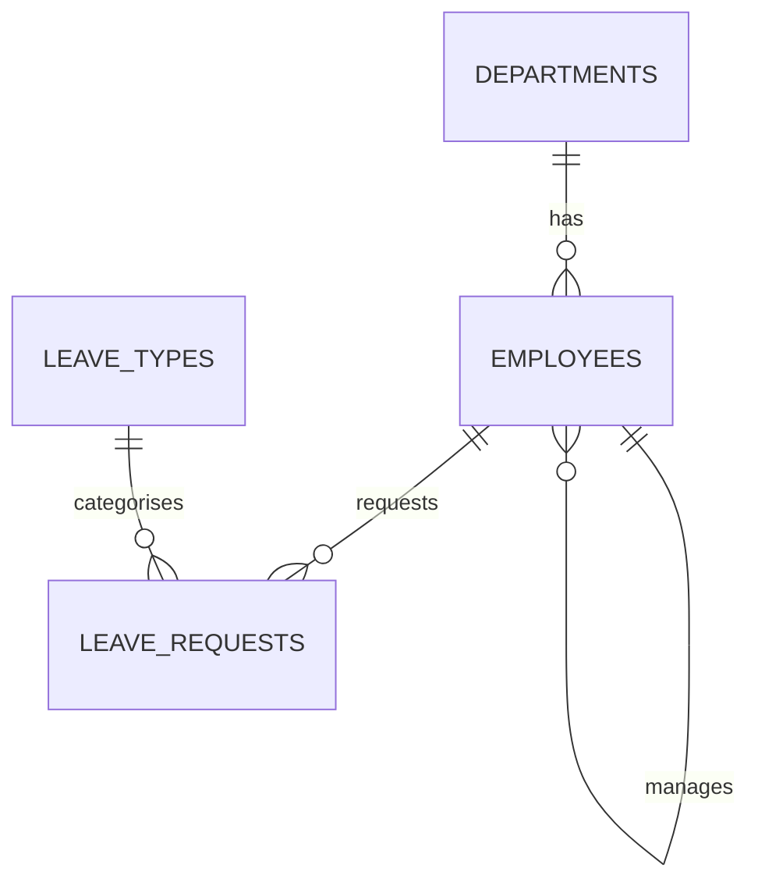

# Leave Desk (Backend)

A REST API for employee leave management, built with **Spring Boot** and **PostgreSQL**. Employees request leave, and managers approve or reject requests from their own team. The API enforces the business rules and the permissions itself, so the frontend cannot bypass them.

Frontend repository: [leave-management-frontend](https://github.com/Kalyani7911/leave-management-frontend)

## Live demo

- Website: **https://leave-management-frontend-psi.vercel.app**
- API base URL: `https://leave-management-backend-ettg.onrender.com`

The API runs on a free hosting plan with a free PostgreSQL database. The server goes to sleep when nobody is using it, so the first request after a quiet period can take up to a minute. After that, it responds normally.

Try the login endpoint with the demo account:

```
curl -X POST https://leave-management-backend-ettg.onrender.com/api/auth/login -H "Content-Type: application/json" -d '{"email":"pravin.patil@example.com","password":"Leave@123"}'
```

## Features

- JWT login with three roles: Employee, Manager and HR
- Leave balance per leave type, calculated from approved and pending requests
- Validation of every request: dates in the right order, no overlapping leave, enough balance
- Ownership rules: you can only request leave for yourself, and a manager can only decide requests from their own team
- One global exception handler, so every error has the same JSON shape
- Database schema managed with Flyway migrations

## Tech stack

- Java 17, Spring Boot 4.2
- Spring Data JPA (Hibernate), PostgreSQL
- Spring Security with JWT (OAuth2 resource server, HMAC-SHA256 signed tokens)
- BCrypt password hashing
- Flyway for versioned database migrations
- Maven, Lombok

## Architecture

The code follows a layered structure, and all business rules live in the service layer.

```
controller   REST endpoints, read the signed-in user from the token
service      business rules (validation, balance, team and ownership checks)
repository   database access (Spring Data JPA, custom queries for overlap and balance)
entity       JPA classes mapped to the tables
dto          request and response objects (entities are never returned directly)
exception    custom exceptions and the global exception handler
config       security configuration (JWT, password encoder, CORS)
```

## Database



- `departments`, `employees` (with a self-referencing `manager_id`), `leave_types` and `leave_requests`
- Primary and foreign keys, unique constraints, and CHECK constraints for roles, statuses and date order
- Passwords are stored only as BCrypt hashes
- Migrations are in `src/main/resources/db/migration`:
  - `V1__init_schema.sql`: tables, keys, constraints and indexes
  - `V2__seed_data.sql`: sample departments, leave types, employees and requests
  - `V3__add_passwords.sql`: adds the password hash column and the demo passwords

## API endpoints

Every endpoint except login needs the header `Authorization: Bearer <token>`.

| Method | URL | Who can call it |
|---|---|---|
| POST | `/api/auth/login` | Anyone |
| GET | `/api/employees` | Any signed-in user |
| GET | `/api/leave-types` | Any signed-in user |
| GET | `/api/leaves/balance/{employeeId}` | The employee, their manager, or HR |
| GET | `/api/leaves/employee/{employeeId}` | The employee, their manager, or HR |
| GET | `/api/leaves/pending?managerId={id}` | That manager, or HR |
| POST | `/api/leaves` | A signed-in user, for themselves only |
| PUT | `/api/leaves/{id}/approve` | The employee's manager, or HR (never your own request) |
| PUT | `/api/leaves/{id}/reject` | The employee's manager, or HR (never your own request) |

Example login request:

```json
{ "email": "pravin.patil@example.com", "password": "Leave@123" }
```

Example error response (the same shape is used for every error):

```json
{ "status": 400, "message": "You already have leave on these dates" }
```

Status codes: 400 for broken business rules or invalid input, 401 for a wrong login or missing token, 403 for an action that is not allowed, 404 when something does not exist.

## Business rules

When leave is requested, the service checks these in order:

1. The request is for the signed-in user.
2. The end date is not before the start date.
3. The employee and the leave type exist.
4. The dates do not overlap with pending or approved leave.
5. Days already taken or waiting, plus the new days, do not exceed the yearly quota of that leave type.

Only pending requests can be approved or rejected.

## Run it locally

You need JDK 17 or newer and PostgreSQL.

1. Clone the repository:

   ```
   git clone https://github.com/Kalyani7911/leave-management-backend.git
   cd leave-management-backend
   ```

2. Create an empty database named `leave_db`. Flyway creates the tables and sample data when the app starts.

3. Set two environment variables. `DB_PASSWORD` is your PostgreSQL password, and `JWT_SECRET` is a random secret of at least 32 characters used to sign tokens.

   On Windows (PowerShell), then reopen the terminal:

   ```
   setx DB_PASSWORD "your-postgres-password"
   $b = New-Object byte[] 48; (New-Object System.Security.Cryptography.RNGCryptoServiceProvider).GetBytes($b); setx JWT_SECRET ([Convert]::ToBase64String($b))
   ```

   On macOS or Linux:

   ```
   export DB_PASSWORD="your-postgres-password"
   export JWT_SECRET="$(openssl rand -base64 48)"
   ```

4. Start the API on http://localhost:8080:

   ```
   ./mvnw spring-boot:run
   ```

   On Windows use `.\mvnw spring-boot:run`.

## Demo accounts

All demo accounts use the password `Leave@123`.

| Role | Name | Email |
|---|---|---|
| Employee | Pravin Patil | pravin.patil@example.com |
| Manager | Rahul Joshi | rahul.joshi@example.com |
| HR | Anita Deshmukh | anita.deshmukh@example.com |

## Known limitations and ideas for next steps

- The employee list is visible to every signed-in user. A real system would limit it.
- The demo accounts share one password. A real system would add password change and reset.
- CORS allows only `http://localhost:3000`.
- Planned: leave cancellation, a holiday calendar, email notifications, and unit and integration tests.